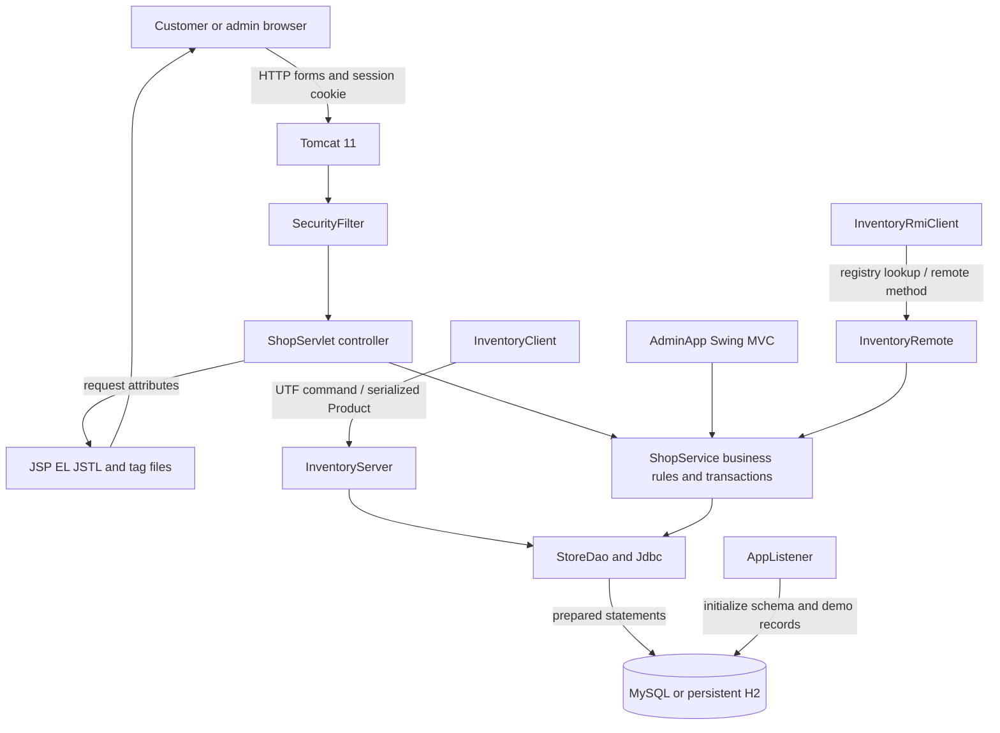
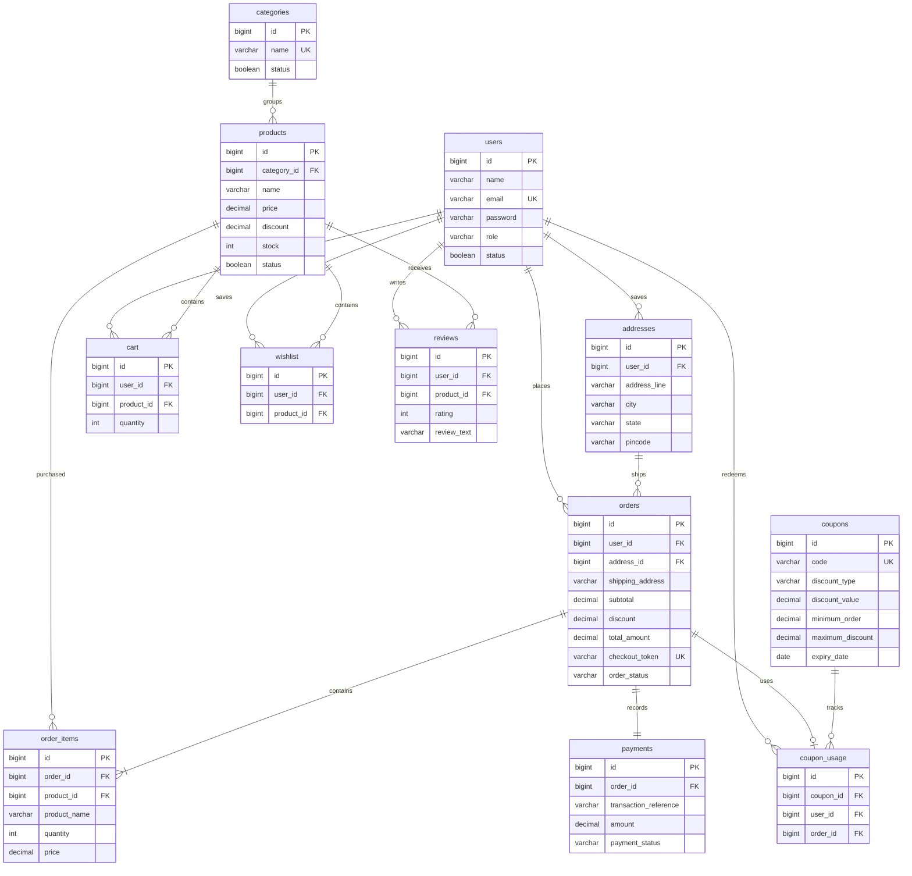
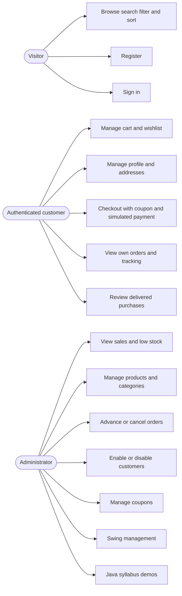
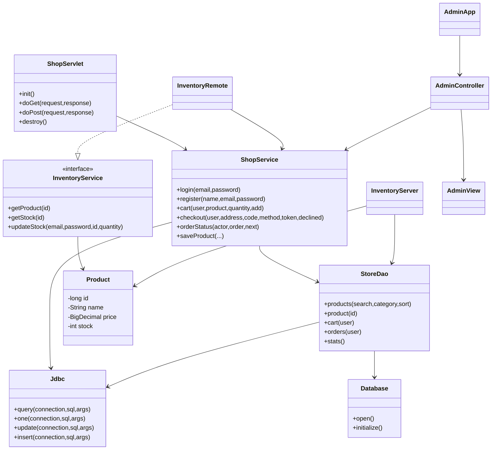
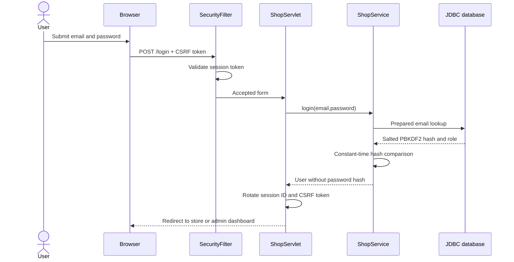
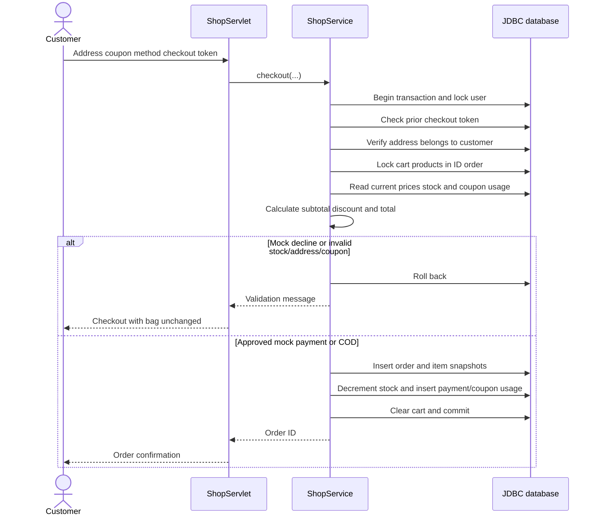

# ShopSphere design diagrams

## System architecture

## Database ER diagram

Cart, wishlist and reviews each have a unique `(user_id, product_id)` key. Coupon usage has a unique `(coupon_id, user_id)` key. Order records store shipping-address, item-name and price snapshots so subsequent catalog/profile changes do not rewrite history.

## Use cases

## Class relationships

The network Product is a typed serializable DTO. JDBC page records are maps keyed by column names and passed as request attributes for JSP EL. Queries execute through DAO helpers; services coordinate business rules and transactional writes.

## Login sequence

## Order sequence

