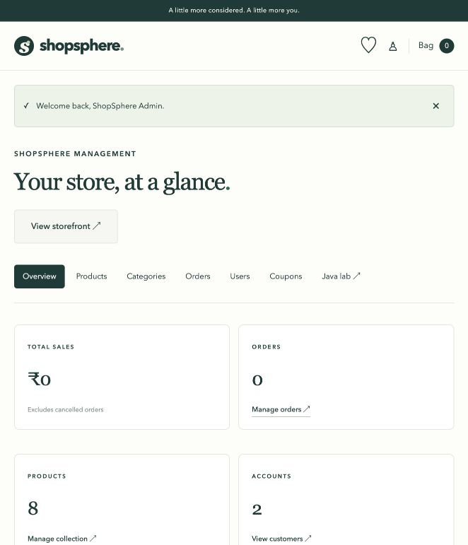
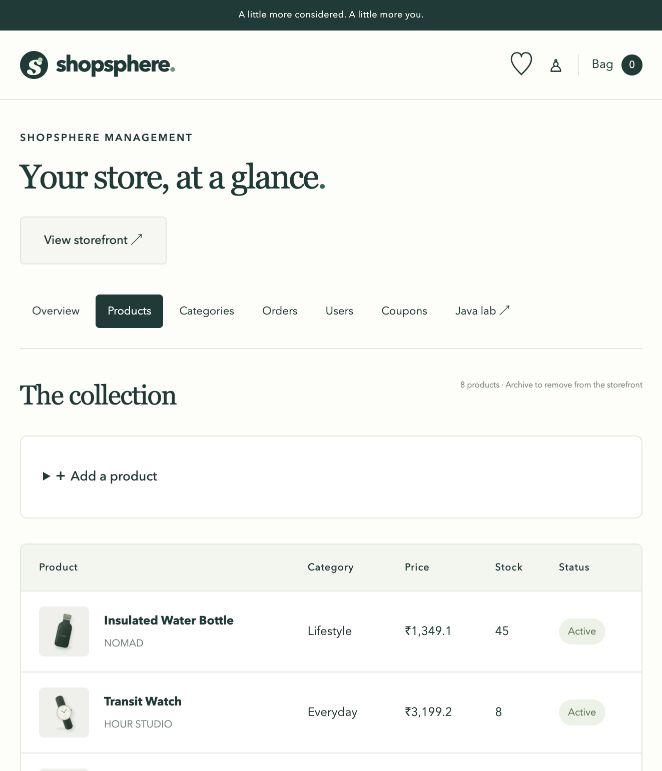
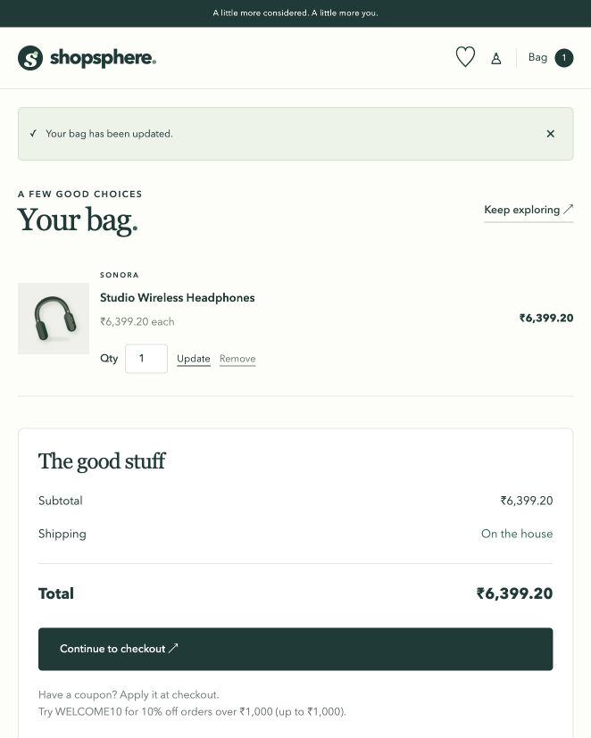
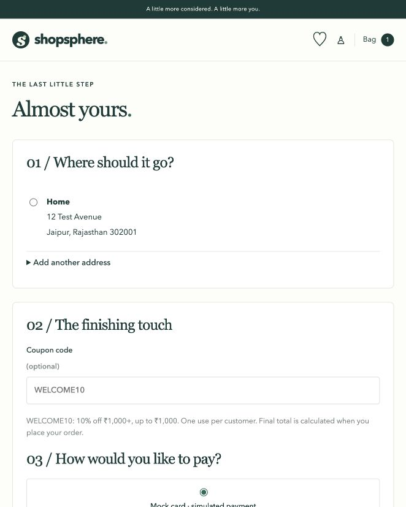

# ShopSphere Advanced Java project report

## Introduction

ShopSphere is an educational e-commerce management application that connects the RTU Advanced Java syllabus to a complete shopping workflow. Customers can find products, save favourites, manage a bag and delivery addresses, place simulated orders and track fulfilment. Administrators manage the catalog, inventory, coupons, customers and orders through a browser or a Java Swing desktop client.

The implementation is available as source code, a Maven WAR, database schema, launch scripts and automated tests. A local persistent H2 mode makes the application demonstrable without database installation. A MySQL configuration and Docker deployment are supplied for the guide's target database.

## Problem statement

An e-commerce system needs more than independent CRUD screens. Product availability, prices, addresses, promotions and payment results must form one consistent order. Authentication and authorization must protect private orders and administrative actions. The same inventory should also be available to desktop and distributed Java examples without duplicating business rules.

ShopSphere solves this through server-side price calculations, prepared JDBC statements, role checks, sessions, transactional checkout and shared services. Networking and syllabus-specific JSP examples stay isolated from the normal customer journey.

## Objectives

- Implement a complete customer flow from registration and product discovery to order history and review.
- Maintain catalog, stock, customers, coupons and fulfilment through web and Swing interfaces.
- Demonstrate Servlet/JSP, MVC, JDBC, sessions, filters, listeners, EL, JSTL and reusable tags.
- Provide working socket serialization and RMI inventory examples.
- Supply deployment guidance, diagrams, test cases, screenshots and viva notes.

## Requirements and technology

| Layer | Implementation |
| --- | --- |
| Language | Java 17 target |
| Container | Tomcat 11.0.27, Servlet 6.1 / JSP 4 |
| Build | Maven 3.9.11 launcher and WAR packaging |
| Presentation | JSP, EL, JSTL 3, local responsive CSS/JavaScript and SVG illustrations |
| Persistence | JDBC with prepared statements; MySQL Connector/J; local H2 MySQL mode |
| Desktop | Swing view/controller, shared services, SwingWorker |
| Networking | Socket/ServerSocket, Data streams and Java object serialization |
| Distributed services | RMI remote interface, registry, exported service and client |
| Testing | JUnit 5, real JDBC/socket/RMI integration tests, HTTP journey runner |

The UI uses custom CSS and local assets; it does not require Bootstrap or a CDN. This supports offline browser demonstrations after Maven dependencies have been downloaded. The code uses one consolidated HTTP controller and security filter with route dispatch rather than a class for every page.

## Architecture

See [design diagrams](DIAGRAMS.md) for the architecture, ER, use case, class and sequence diagrams.

Tomcat accepts HTTP requests, applies SecurityFilter, then dispatches to ShopServlet. The controller validates route inputs and invokes ShopService. StoreDao and Jdbc execute prepared queries; ShopService coordinates transactions and write operations through Jdbc. JSPs render request/session attributes using EL, JSTL and tag files. All normal mutations use POST and redirect after processing.

Swing AdminView displays tables and forms while AdminController calls the same services using background workers. The socket inventory server uses read-only DAO queries. InventoryRemote uses the shared service for authenticated stock updates. All modules connect through the same JDBC configuration.

## Database design

The schema contains 12 tables: users, addresses, categories, products, cart, wishlist, orders, order_items, payments, reviews, coupons and coupon_usage. Foreign keys preserve relationships. Unique constraints prevent duplicate emails, repeated cart/wishlist entries, repeated product reviews and repeated coupon redemption by the same customer. Monetary fields use DECIMAL; Java calculations use BigDecimal.

Order items store names and purchase prices. Orders store shipping-address text as a snapshot. These preserve historical details after later edits. Products and categories use archive flags rather than hard deletion; checkout rejects inactive items/categories.

The schema file is `database/shopsphere.sql`. Java initializes the same schema and seeds demo users, eight products, four categories and WELCOME10 on a fresh database. Password hashes are generated at initialization rather than embedding plaintext passwords in SQL.

## Customer module

Visitors can browse, search descriptions/brands/names, filter categories and sort by price or name. Product details show selling price, stock, description, community reviews and related products. Product cards reuse a custom JSP tag.

Registration validates email and password length. Login verifies a salted password hash and rotates the HTTP session ID. Customer profile editing, delivery-address saving and address removal operate on the signed-in account. Orders can reference only addresses owned by that account.

Cart and wishlist records persist in JDBC storage. Adding checks available stock; updating recalculates totals; setting quantity to zero removes an item, including items archived after they were added. Wishlist heart controls toggle the saved record.

Checkout supports an optional coupon, approved/declined mock card outcomes and COD. No real card data is collected. WELCOME10 provides 10% off a minimum ₹1,000 spend, capped at ₹1,000, once per customer. Coupon rules are enforced by the server using current database data.

## Transactional order placement

Checkout begins one JDBC transaction. It locks the active user, checks for a previously completed checkout token, verifies address ownership, and locks cart products in ID order. It reads current prices and stock rather than trusting any browser total. It verifies coupon activation, expiry, minimum spend and previous usage.

The service calculates item prices, subtotal, coupon savings and final total using decimal arithmetic. A simulated decline raises a validation failure and rolls back. An approved mock payment or COD creates the order, item snapshots, payment and coupon usage, decrements stock and clears the cart. All writes commit together. Failure rolls back all changes. A unique checkout token prevents duplicate placement.

Customers see order history and tracking. Reviews require a delivered order for the product and are unique per customer/product; a subsequent review submission updates the existing review.

## Administration

The dashboard shows order count, accounts, catalog size, non-cancelled sales value, recent orders and low-stock products. Product/category forms create and edit records and archive storefront entries. Product stock can be updated directly. Coupon forms manage type, value, minimum, cap, expiry and activation. Customer accounts can be disabled; the active admin cannot disable itself.

Orders move through PLACED → PROCESSING → SHIPPED → DELIVERED. Cancellation is allowed before shipment, restores stock once, releases the coupon usage and records a simulated refund for paid mock orders. COD is marked paid on delivery. Invalid transitions are rejected.

Swing administration shares these rules. The desktop contains products, categories, orders, users and coupons tables, record forms, stock/status operations and refresh controls. Database work uses SwingWorker rather than blocking the event dispatch thread. Web and desktop changes become visible through the same database.

## Syllabus demonstrations

Admin-only Java lab pages demonstrate traditional JSP elements, JSTL SQL on an isolated teaching DataSource, JSTL XML on a local product feed, ResourceBundle headings, JSP EL/functions and reusable rating tags. Servlet initialization, application context and session listener events are implemented in the main app.

The socket server accepts GET_PRODUCT, GET_STOCK and SEARCH_PRODUCT commands over loopback. It serializes Product return objects or search lists to the client. The client restricts deserialized classes, depth and response size.

The RMI server starts a local registry, binds ShopSphereInventory and exports a remote inventory implementation. Clients discover the service through registry lookup. Administrative stock updates authenticate credentials and role before invoking the shared service.

URLConnection demonstrates protocol selection and content type against the health endpoint. JndiDemo demonstrates a container resource lookup when its optional DataSource is configured. A historical applet source demonstrates lifecycle methods but remains excluded from the supported modern build.

The detailed [syllabus and viva guide](SYLLABUS_AND_VIVA.md) maps each topic to code or a live demonstration.

## Security and validation

Passwords use salted PBKDF2-HMAC-SHA256 with 210,000 iterations and a 256-bit derived key. SQL input binds through prepared statements. The security filter checks authenticated account status on each request, checks admin roles, rejects invalid CSRF tokens and sets defensive response headers. Login rotates session ID; logout invalidates the session.

Database reads for customer orders and addresses include ownership conditions. Administrative service methods repeat the role check so non-web clients cannot bypass it. JSP customer-entered text is escaped. All totals, stock and coupon checks run on the server. Mock payment methods are explicitly allowlisted. Session cookies are HttpOnly, recent-product cookies contain only a product identifier, and no passwords are put in cookies.

The local launcher and educational distributed services bind to loopback. Public deployment requires additional operational controls described under limitations.

## Testing and results

The Java suite verifies authentication, password hashing, DAO search, cart/wishlist behavior, inactive product removal, transaction rollback, discount cap, ownership, coupon usage, fulfilment, verified reviews, archive operations, authorization, stock contention and real socket/RMI calls. The separate HTTP runner follows 17 real browser-form journeys against Tomcat, including JSP compilation and error status behavior.

See [test cases and results](TESTING.md). Development verification uses the H2 database; MySQL Compose has not been runtime tested on this host because Docker's daemon is unavailable. Standalone target environments should run the HTTP runner against their disposable database before demonstration.

## Screenshots

### Responsive storefront

### Administration dashboard

### Product management

### Cart and checkout

## Installation and handover

Run `./scripts/run.sh` and open `http://localhost:8080`. Customer credentials are `alex@shopsphere.local` / `Shop@12345`; admin credentials are `admin@shopsphere.local` / `Admin@12345`. Build/deploy `target/shopsphere.war` with `./mvnw clean verify`. The complete [setup guide](SETUP.md) covers JDK selection, local H2, MySQL, Docker Compose, standalone Tomcat, Swing, sockets, RMI, JNDI and troubleshooting.

## Limitations and future scope

Payments/refunds are simulated, shipping is free, and taxes or external delivery updates are not modeled. Internationalization demonstrates English/Hindi headings rather than translating the complete catalog/UI. Images are a curated local illustration set rather than an upload service. JNDI needs explicit container configuration. Applets require obsolete tooling and are historical source only. The schema initialization is intended for a new coursework database rather than a versioned production migration system.

Future production work includes real payment-provider webhooks, shipping/tax integration, login rate limiting, email verification, account recovery, connection pooling, audit logging, versioned migrations, full translations, monitoring and secure HTTPS deployment. MySQL runtime validation remains required for the supplied MySQL target configuration.

## Conclusion

ShopSphere provides a complete local shopping and administration workflow while connecting web, desktop, JDBC, networking and distributed Java topics through one shared application. Source, tests, deployment artifacts and demonstration documentation support practical execution and a technical viva.

## References

- [Apache Tomcat 11 migration guide](https://tomcat.apache.org/migration-11.0.html): Java baseline and Jakarta specifications.
- [Apache Jasper guide](https://tomcat.apache.org/tomcat-11.0-doc/jasper-howto.html): JSP compilation and runtime.
- [H2 features](https://h2database.com/html/features.html): MySQL compatibility and mixed local access.
- Supplied ShopSphere Advanced Java project guide: requirements and RTU topic mapping.
